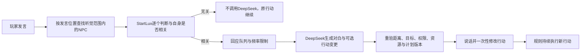

# 按需对话与持续行为架构

状态：原始设计规格与当前实现对照。当前源码已接入近距离听众队列、StartLux相关性门控、DeepSeek回应队列及主动发言调度；完整玩法与性能尚未验收。下文保留设计目标与建议参数，不表示全部细节已经实现或验证。本规格替代早期文档中“StartLux 仅为可选次要决策”的定位，角色类型与关系库继续使用。

## 1. 三层职责

1. **规则行为层持续运行。** 移动、采集、进食、跟随、保护、自卫、追击和撤退不调用语言模型。人格和关系影响规则参数及允许行为，但无需为53种类型写53套状态机。
2. **StartLux 事件筛选。** 只在附近出现发言或少量主动搭话候选时，判断该事件是否与指定NPC有关、是否值得在此时开口。不生成对白，也不批准资源变化。
3. **DeepSeek 按需响应。** 筛选通过且调度预算允许时，读取该NPC的人设、已知关系、实际大小、当前计划和局部事实，生成一句回应及可选行动变更。游戏再次校验后执行。

对话是改变行动的事件，不是维持行动的心跳。一次同意跟随之后，由规则持续跟随；无需重复问模型是否还要跟随。

## 2. 玩家发言流程

- 使用发言者的实际位置与听众的空间距离，不广播给全地图。首版只做距离筛选，不增加声音传播、墙体衰减或复杂听觉模拟。
- 听众在发言时确定；晚走进范围的NPC不能自动听见之前的话。入队前、调用云端前及应用回复前都检查对象是否仍有效、是否仍在本次可交谈范围。
- 相关性不限于点名：谈到自己的粮食、自己控制的果林、自己保护的人、正在与自己冲突的人，也可能相关。泛泛聊天不必让所有人插话。
- “与我有关”不等于“我同意”或“我愿意帮忙”；拒绝、警告和反问也由DeepSeek按人格决定。明确点名同样需要本地判定，不绕过该层。
- 相关者排队，点名对象优先，其次直接涉事者、最后旁观者。不是所有人同时出声；限额未处理或过期的消息标记为未响应，不伪记为“不相关”。
- 首版每次发言最多安排2个NPC回应，是建议的成本/噪声预算，可调整；所有在范围内的候选仍按队列筛选，不因类型或名字不在当前对话框中就假装没听见。
- 每个NPC只得到自己的知识和相关局部事实，不把整个关系网络、远处事件和其他人的私有记忆都放进提示词。

## 3. 主动对话与NPC之间对话

主动调度不是持续让模型自由聊天。规则先检测新的处境：初见、体型区间变化、缺粮、刚被帮助/攻击、关系对象出现、共享请求受阻或完成等，再生成一个低频候选。

流程为：规则发现具体原因 → 选附近说话者和对象 → StartLux判断是否值得开口 → DeepSeek生成开场与可选行动 → 发布同一种发言事件。NPC听到这句话后，也先通过StartLux相关性筛选再进入DeepSeek；玩家是否回应由真人决定，模型不代替玩家说话。

首版主动模拟只覆盖玩家附近的活动区域。区域外角色继续既定规则行为，不在后台进行大量模型聊天。NPC之间的发言只有玩家也处于该说话者听觉范围内才显示给玩家，不把远处对话当作玩家已知情报。

防止接话循环：

- 每句话有唯一消息ID、说话者实例ID和对话链ID；说话者不收听自己的消息，同一听众只处理一次。
- NPC回复沿用原对话链，不算一次新的主动事件，不能因“听到回复”再次开启全新链。
- 首版一条自动对话链最多生成2句NPC对白（例如A开场、B回复），随后收束。玩家新输入可以开启新一轮。
- 同一处境不重复邀请；需要库存、关系、威胁或任务阶段等实际变化才能再次形成候选。
- 明确与处境无关的消息不进入云端。StartLux超时/不可用时保留行动并结束或延后该事件，不直接转发DeepSeek。

## 4. 对话怎样改变行动

输出仍尽量沿用 `say/action/target/amount`。消息ID、场景版本与行动版本由引擎附带，不让模型自己填写或证明。

| 输出 | 状态变化 | 后续如何运行 |
|---|---|---|
| `none` | 只说话，不清空或重置已有计划 | 继续原来的采集、跟随或等待 |
| `follow(B)` | 切换为纯跟随B | 持续由规则跟随，直到解除、目标失效或新的有效命令 |
| `protect(B)` | 记录保护对象B | 规则决定站位、发现威胁、援护与安全撤退 |
| `attack(B)` | 记录敌对目标B | 规则控制接近、挥击、距离判断、受伤与退让 |
| `steal(B,n)` | 安排一次近距离抢夺尝试 | 一次性执行并结算；失败/完成后结束，不能每帧重复扣粮 |
| `give`、`donate`等既有动作 | 建立或执行受约束的转移/供奉 | 扣粮和送达以世界实际事件为准 |
| `stop`、`truce(B)` | 结束相应计划或按合法范围解除敌对 | 回到该角色的默认规则；不替第三人承诺停战 |

移动和战斗照常逐帧或按引擎既定步长执行；行为选择只需定时或事件驱动更新。建议统一优先级：死亡/即时危险 → 自卫与撤退 → 当前保护/攻击/供奉等有效计划 → 口粮与恢复需求 → 日常采集/巡游/等待。紧急避险可以暂时覆盖计划，安全后再恢复，不用再次请求模型维持承诺。

等待网络时原行为继续。不能因为 `bBusy` 就全局暂停，也不能让收听者在云端回复期间站着不动。若需要当面交谈时停步，应是一个短、有超时的规则行为，且自卫始终可中断，不能与HTTP等待状态绑定。

## 5. 初始频率与范围

以下是建议配置，尚未进行玩法或性能验证；不代表角色会严格按秒数机械开口。

| 项目 | 建议初值 |
|---|---|
| 发言听觉半径 | 20米（UE默认单位下2000厘米） |
| 主动对话调度活动半径 | 玩家周围50米；听众仍须在说话者20米内 |
| 玩家发言筛选 | 每次发言触发一次，不轮询；快速连续输入合并/节流 |
| 同NPC回应节流 | 约3秒；不影响既有自卫/行动 |
| NPC主动向玩家开口 | 每人60–120秒随机冷却，且必须有新原因 |
| NPC主动向NPC开口 | 同一对120–240秒冷却，且必须有新原因 |
| 全局主动事件间隔 | 至少20秒；优先响应玩家输入 |
| StartLux并发 | 1；先排队、按有界批次处理 |
| DeepSeek并发 | 初版1；单NPC最多1个待回复 |
| 自动链长度 | 最多2句NPC生成对白 |
| 待回应事件有效期 | 初版20秒，过期丢弃并记录原因 |

StartLux的现成GGUF适配层可接收多项问题，但实现仍会分别计算问题。多问题HTTP请求不能假称一次廉价推理；首版按有限候选批次排队，避免一个拥挤场景塞满4096上下文或占用主线程。

## 6. 迟到回复与低频调用的边界

一次发言触发的动作最多生效一次。应用前重新检查说话/收听双方是否存活、距离、当前库存、目标关系、合法动作，以及该NPC的计划是否已被更新。

例如NPC等待“跟随”回复时已经遭袭开始逃跑：迟到的回复不得覆盖逃跑去送死。若战斗仅暂时打断长期计划，可由规则保留待恢复计划；若玩家已经发出停止指令，则旧回复作废。只跟踪影响该请求的版本，不因无关角色动了一步就作废全世界请求。

请求成功判定与对话调度分开运行。供奉真实送达、目标死亡、威胁消失、果林权限改变等直接更新共享事件；不用再问DeepSeek事件是否成功。需要表达时，再按冷却与范围生成一条新对话候选。

## 7. 当前源码实现对照

- `UVerdantDialogue` 已建立近距离听众队列、StartLux筛选和云端回应队列；本地筛选失败时不会直接绕过门控调用DeepSeek。
- 通用说话者/听众检查使用20米听觉范围，NPC主动发言和NPC之间的回应进入同一调度路径。
- `VerdantNPC.cpp` 已解除基于 `RequestNPC`/`bBusy` 的网络等待停步；规则行为继续执行。
- 主动上下文明确标记为游戏提供的触发事实，不伪造玩家发言。回应执行前检查生命、意图版本、距离及合法行动，避免迟到结果覆盖新状态。
- FollowId、HostileId、DonationPledge 等规则意图继续保留，`none` 不重置现有计划；共享事件和人格关系的实现仍属于设计库的子集。

以上为静态源码中的实现状态，不代表本规格所有细节或角色关系均已完成，也不代表真实服务调用、拥挤场景和完整互动已经验收。建议参数仍需结合后续获准的针对性检查与用户人工试玩调整；既有历史测试不能自动覆盖本轮实现。
